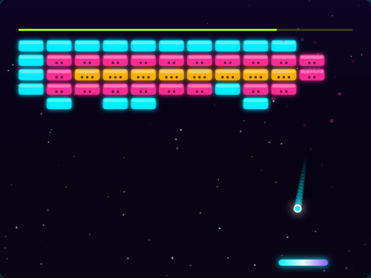
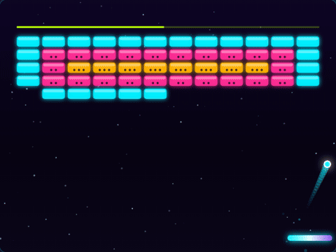

# Neon Void Breaker

**A neon brick-breaker roguelite.** Break bricks, build combos, dodge void gravity wells, and draft upgrades between levels.

🎮 **Play it live:** https://namdev-muse.github.io/neon-void-breaker/






## How to play

Bounce the ball with your paddle to smash every brick. Chain brick breaks without missing to raise your combo multiplier (up to ×5). Clear the board to advance. Lose the ball and you lose a life — lose all 3 and the run ends.

| Control | Action |
|---|---|
| Mouse / touch drag / ← → (or A / D) | Move paddle |
| Space / tap | Launch ball, pause |
| P / Space | Pause / resume |
| Esc | Pause / resume (quit to menu from game over) |
| R / N / Q (while paused) | Resume / restart / quit to menu |
| M | Mute / unmute |
| Enter / Space | Start, advance |
| 1 / 2 / 3 (or ← → + Enter) | Pick an upgrade in the draft |

## Features

- 10 hand-designed levels with multi-hit bricks (Block 15)
- New brick types (Block 17): green ↔ movers slide sideways across their row, orange ✸ exploders chain-damage all 8 neighbours when destroyed (and chain into each other), and sky-blue ↻ regenerators come back 20s after being broken — twice each — unless you clear the level first; a ghost outline with a refill bar shows where one is about to return
- Void gravity wells (Block 9): from level 2, black holes bend the ball's path inside their telegraphed pull ring and swallow any ball that crosses the event horizon — then go sated for 5s. Each well wakes for 2.5s of every 8s cycle and stirs visibly for 1s first (the ring brightens), so you can time your shots around it; watch the rim flare pink as a ball nears the maw. A well eats at most one ball per level — once fed it only bends the ball, harmlessly. Serves are shielded from the wells for 1.2s, and the paddle respawns at center after a swallow. Level 5 hides one big maw dead center
- Powerups: multi-ball, wide paddle, laser paddle (Space to shoot, 12s), slow-mo (0.6× ball speed, 10s), shield (bottom net saves one lost ball), fireball (piercing ball, 10s), and void bomb (160px blast that shatters nearby bricks, 2 HP each) drop from broken bricks (12% chance) — catch the capsule to activate; HUD shows active timers as coloured chips with countdown bars (Block 11, Block 12, Block 15)
- Seeded level variations (Block 15): layouts vary by seed — everyone plays the same walls each day, and `?seed=XXXX` in the URL shares one; the seed shows on the menu
- Two Void Core mini-bosses (Block 10, Block 15): clearing level 5 wakes the 12-HP Void Core, clearing level 10 wakes the 16-HP Void Core Prime — each must be destroyed to advance
- Roguelite upgrade draft: after every level clear, pick 1 of 3 upgrades (extra life, wider paddle, ball control, score boost, magnet paddle, twin launch) — they stack and last the whole run (Block 6)
- Run stats: best combo, bricks broken, shot accuracy, and powerups caught/missed shown on the game-over screen (Block 6)
- Pause menu with run snapshot, restart, and quit-to-menu (Esc / P / Space to pause &amp; resume) (Block 7)
- Local top-5 high-score table on the menu and game-over screens, with a ★ NEW BEST! ★ badge and your rank highlighted (Block 7)
- Touch polish: drag the paddle with your finger, tap to launch, no page scroll or pull-to-refresh while playing, no long-press menu (Block 8)
- Full keyboard-only play: Space/Enter start and advance, R/N/Q pause-menu shortcuts, ← → moves focus across draft cards, every overlay focuses its primary button, visible focus rings (Block 8)
- Small-phone responsive pass: 3-column HUD, shrinking draft cards, safe-area padding, landscape mode hides the help text and fits the canvas to the viewport height (Block 8)
- Combo multiplier with decay timer + on-screen combo bar
- Juice: particles, screen shake that scales with break size and combo, hit-stop freeze frames, impact flashes, shockwave rings, long ball trail, floating score popups, level-clear confetti burst (Block 12)
- Synthesized Web Audio sound effects (zero audio files)
- Auto-play bot harness (Block 11): `node tests/bot-harness.js` plays full runs headlessly in a stubbed DOM and reports coverage (levels cleared, powerups, wells, boss) plus bug detectors for ball tunneling, stuck balls and NaN velocities — run it before every push
- Background music loop: synth arpeggio (Am–F–C–G) with bass and hats that intensify as your combo multiplier climbs (Block 5); while a Void Core lives, the music turns darker (Am–F–E–G) and holds at ×3 intensity for the boss fight (Block 17)
- High score saved locally, auto-pause when the tab hides
- Fully responsive — desktop and mobile, no build step

## Coming up (12-hour sprint roadmap)

Achievements, more powerups, accessibility and cross-browser passes,
PWA-lite polish, and a v1.0 release. Follow the build in [docs/devlog.md](docs/devlog.md).

## Tech

Vanilla HTML / CSS / JavaScript, Canvas 2D, Web Audio API. No dependencies, no build step — the game is `index.html` + `style.css` + `game.js`.

## Run locally

```bash
# any static server works, e.g.:
python3 -m http.server 8000
# then open http://localhost:8000
```

Or just open `index.html` in a browser.

## Testing

Headless playtest bot — no browser needed:

```bash
node tests/bot-harness.js            # 2 full runs (default)
node tests/bot-harness.js 3 200000   # 3 attempts, 200k frames each
```

The bot plays real runs in a stubbed DOM, tracks the ball with the paddle, drafts upgrades, and reports coverage (levels cleared, powerups caught, wells, boss, max combo) plus bug detectors: ball tunneling through the paddle, stuck balls, NaN positions/velocities, and per-frame speed violations. It exits non-zero if any detector fires or no level is cleared. Run it before every push.

## Deploy

Pushes to `main` run CI (JS syntax check + file checks) and deploy to GitHub Pages via GitHub Actions (`.github/workflows/ci-pages.yml`).

> One-time setup: in the repo, go to **Settings → Pages → Build and deployment → Source** and choose **GitHub Actions**.

## License

MIT — see [LICENSE](LICENSE).

Built by Iggy in a 12-hour autonomous sprint with Nam. 🚀
