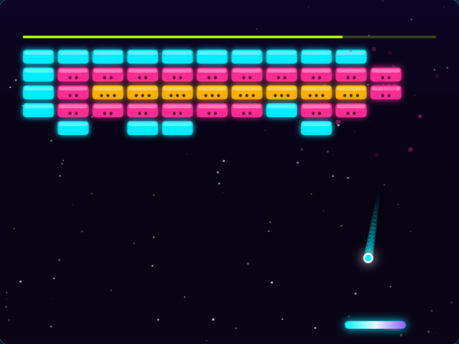

# Neon Void Breaker — Devlog

A neon brick-breaker roguelite built in a single 12-hour sprint
(Thu 2026-11-19, 00:10–12:10 Asia/Bangkok), in 24 half-hour blocks.
Vanilla HTML/CSS/JS, Canvas 2D, Web Audio synth — no build step, no
dependencies. Play it live:
https://namdev-muse.github.io/neon-void-breaker/

## The game in one paragraph

Break bricks, build combos, dodge void gravity wells, and draft upgrades
between levels. Six hand-designed levels, a mini-boss at the end of level 5,
six powerups, and a 1-of-3 upgrade draft after every clear. Lose the ball,
lose a life; lose all three and the run ends. Your best runs live in a local
top-5 table.

## Block by block

### Block 1 — Core engine
Paddle, ball, bricks, collision, score, lives. Repo created, GitHub Pages
live within the first half hour.

### Block 2 — Levels + progression
Levels 1–6 with hand-designed layouts, a speed/HP difficulty ramp, and
named level-intro cards ("FIRST CONTACT" and friends).

### Block 3 — Powerups
Capsules drop from broken bricks: multi-ball (up to 5 balls), wide paddle.
Caught by the paddle, lost if they fall past it.

### Block 4 — Juice pass 1
Particles, screen shake scaled to break size and combo, hit-stop freeze
frames on big breaks, impact flashes, shockwave rings, a long ball trail.
Also fixed the first real bug the juice exposed: a vertical-loop where the
ball could bounce straight up and down forever.

### Block 5 — Audio
Synthesized Web Audio SFX (zero audio files) and a synth-arpeggio music
loop (Am–F–C–G) with bass and hats that intensify as the combo multiplier
climbs. M mutes.

### Block 6 — Roguelite draft
After every level clear, pick 1 of 3 upgrades: extra life, wider paddle,
ball control, score boost, magnet paddle, twin launch. They stack for the
whole run. Run stats tracked: best combo, bricks broken, shot accuracy,
powerups caught/missed.

### Block 7 — UI
Pause menu with run snapshot, restart, and quit-to-menu. Game-over screen
with stats, a ★ NEW BEST! ★ badge, and the local top-5 high-score table.

### Block 8 — Mobile + keyboard
Touch drag to move, tap to launch, no scroll or pull-to-refresh while
playing. Full keyboard-only play: menus navigable by keys, draft picks by
1/2/3 or arrow keys + Enter, visible focus rings. Small-phone responsive
pass, including a landscape mode that fits the canvas to the viewport.

### Block 9 — The signature mechanic: void gravity wells
From level 2, black holes bend the ball's path inside a telegraphed pull
ring and swallow any ball that crosses the event horizon — then go sated
for 5s. Each well wakes for 2.5s of every 8s cycle and stirs visibly for
1s first, so you can time shots around it. A well eats at most one ball
per level. Serves are shielded for 1.2s and the paddle recenters after a
swallow. Balancing this took three full probes: always-on wells ate all
three AI lives on level 2; pulsing wells still did; the final recipe —
gentle bend, launch shield, paddle recenter, one meal per level — lets the
bot clear with one swallow and two lives left.

### Block 10 — Elites + mini-boss
Elite armored brick rows (high HP, big score) and a mini-boss at the end
of level 5: a big brick core with an HP bar. Combo fire effects at high
multiplier — the ball glows and throws flame particles.

### Block 11 — Playtest + bugfix pass 1
Laser paddle (Space to shoot), slow-mo (0.6× ball speed), and shield
(bottom net saves one lost ball) powerups. The headless bot harness caught
two real bugs before they shipped: slow-mo re-catch compounded the speed
cut, and a 4px laser bolt could sail through a 6px gap between bricks.
Both fixed; bolts now collide 8px wide. Also closed the ball-tunneling
audit (4px substeps) and the NaN/zero-velocity guard.

### Block 12 — Fireball + confetti
Fireball powerup: a piercing ball that smashes through bricks instead of
bouncing. Powerup HUD chips with draining countdown bars. Level-clear
confetti burst. The bot harness moved into the repo as
`tests/bot-harness.js` and now runs 33 checks, three times per block.

### Block 13 — README + repo polish
Real gameplay screenshots and an animated GIF, captured by driving the
live game in headless Chromium with the same ball-tracking bot the harness
uses. This devlog, issue templates, and a contributing guide.

### Block 14 — Perf + accessibility + live smoke test
The game now watches its own frame rate: sustained sub-45 FPS switches
to a low-perf mode (no `shadowBlur`, fewer particles, shorter ball
trails) and recovers when the frame rate comes back, so a weak machine
gets a smooth game instead of a stuttering one. Screen-reader players
get a polite live region announcing level clears, lost balls, powerups
and game over; every overlay is a proper dialog and draft cards carry
full aria-labels. `prefers-reduced-motion` turns off shake and confetti.
A new `tests/live-smoke.js` checks the deployed site after every push —
page, bundle and stylesheet all answer 200 and carry the current version
— and retries while GitHub Pages finishes deploying.

### Block 15 — Levels 7–10, seeded layouts, void bomb
The run is now ten levels: Void Maze, Twin Peaks, The Gauntlet, and
Event Horizon join the first six, each with its own void wells — and
clearing level 10 wakes a second boss, the 16-HP Void Core Prime. Layouts
vary by seed: every day plays the same walls, and `?seed=XXXX` shares a
layout with a friend (the seed shows on the menu, and the same seed
always builds the same wall — the harness proves it by comparing layout
signatures). New powerup: the Void Bomb, a capsule that detonates at the
ball nearest the bricks and shatters everything in a 160px radius.

### Block 17 — Moving, exploding and regenerating bricks + boss music

Three new brick types join the walls on levels 2–10. Green ↔ movers
slide sideways around their home column (±28px at 36px/s, alternating
direction by column so a row doesn't march in lockstep); orange ✸
exploders chain-damage all 8 neighbours for 1 HP when destroyed, and a
neighbour that dies as an exploder detonates in turn — the chain only
runs downhill, because damage is only ever dealt to live bricks, and a
chain that finishes the wall clears the level exactly once (the clear
check returns early if the blast already fired it). Sky-blue ↻
regenerators take 2 hits and come back 20 seconds after being broken,
at most twice each — clear the rest of the wall fast enough and the
level still ends before they return; a faint ghost outline with a
refill bar and a rising shimmer SFX mark where one is about to heal.
Movers only slide while playing, never on the serve, so the seeded
layout signature the harness compares at serve time stays
deterministic. For the block's audio theme, a live Void Core swaps the
music to a darker Am–F–E–G progression and holds the intensity at ×3
for the whole boss fight.

## How the game is tested

Every block runs `node tests/bot-harness.js` before pushing: a headless
bot plays full runs in a stubbed DOM, tracking the ball with the paddle,
drafting upgrades, and reporting coverage (levels cleared, powerups,
wells, boss, max combo) plus bug detectors for ball tunneling, stuck
balls, and NaN velocities. It exits non-zero if any detector fires.
The harness has caught three shipping bugs so far — the level-4 bleed-out
balance bug, the slow-mo compounding bug, and the laser gap-tunneling bug.
A second script, `tests/live-smoke.js`, checks the deployed site after
every push: the page, bundle and stylesheet answer 200 and carry the
current version, retrying while GitHub Pages finishes deploying.

The screenshots in this repo were captured the same way: the bot played
the real game in headless Chromium (Playwright) while screenshots were
taken mid-flight. No staged mockups — every pixel is the live game.

## What's next

Achievements, more powerups, accessibility and cross-browser passes,
PWA-lite polish, and a v1.0 release tag. See the roadmap in the README.
